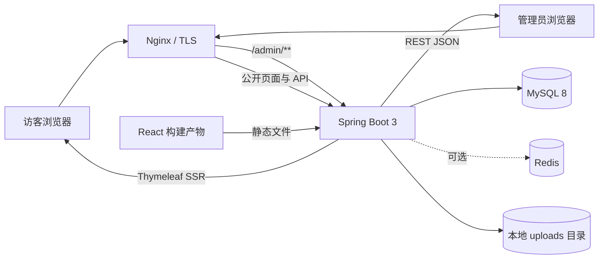
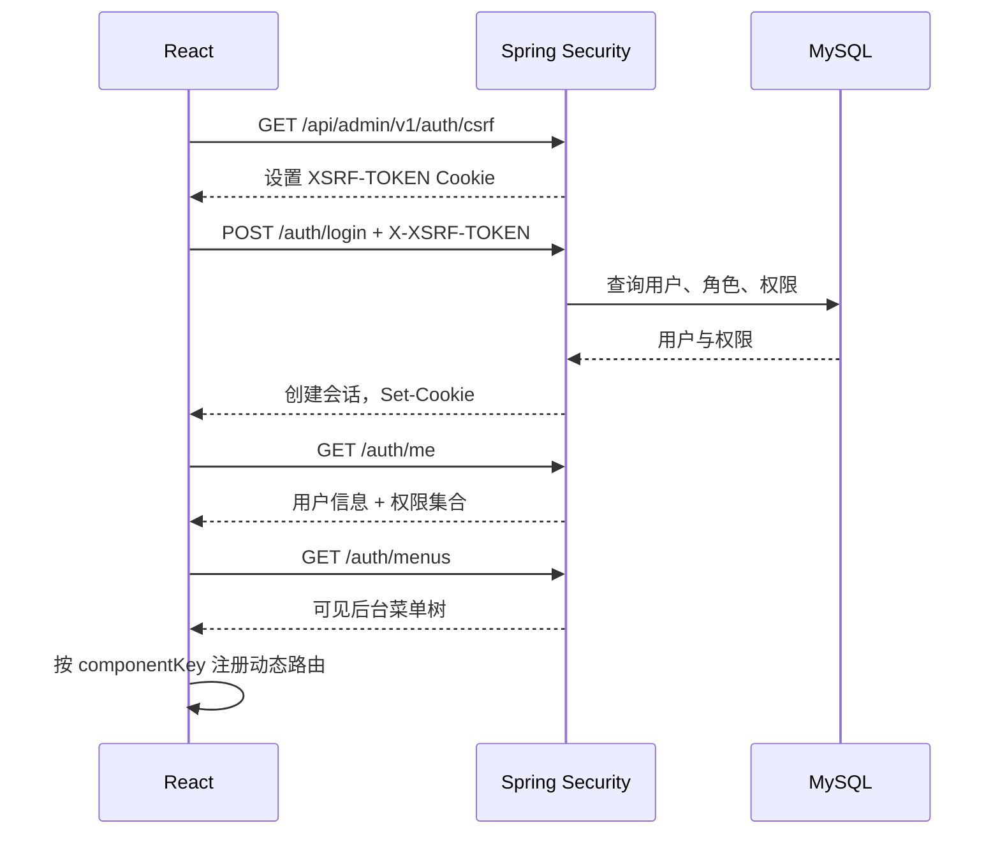
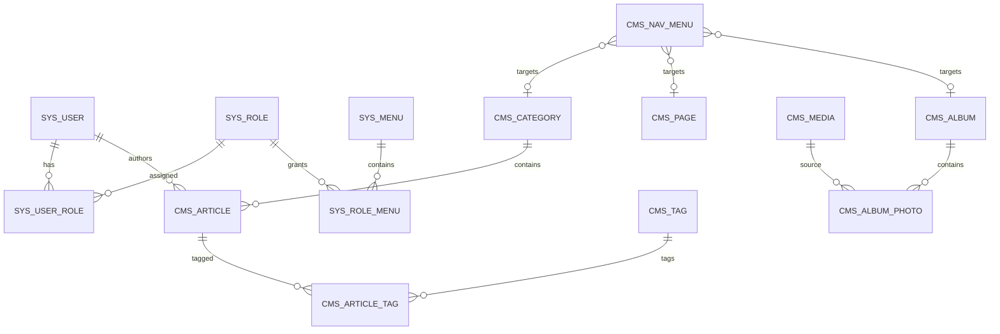
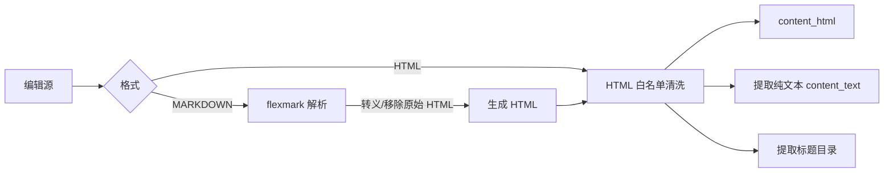
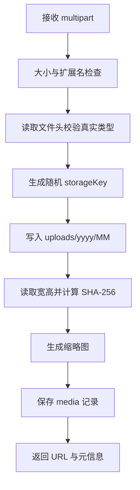

# mz-blog CMS 技术设计文档

| 项目 | 内容 |
| --- | --- |
| 文档版本 | v0.1 |
| 日期 | 2026-10-21 |
| 对应需求 | `docs/01-requirements.md` |
| 架构风格 | 模块化单体（Modular Monolith） |
| 后端 | Java 17 + Spring Boot 3 + Thymeleaf + MyBatis-Plus + MySQL 8 |
| 后台前端 | React + TypeScript + Vite + Ant Design + React Router |
| 部署方式 | 单个 Spring Boot 进程，公开站点与后台 API 同域 |

## 1. 设计目标与约束

### 1.1 设计目标

- 用一个小型团队可以维护的模块化单体完成全部 MVP 功能，不引入微服务复杂度。
- 公开站点由服务端渲染，保证首屏、SEO 和分享卡片效果。
- 后台使用 SPA 提供接近管理系统的交互体验，但认证、权限和业务校验以服务端为准。
- 数据模型覆盖内容、导航、媒体和 RBAC，并为对象存储、Redis、多实例部署保留扩展点。
- 所有关键操作可测试、可审计、可回滚；数据库变更由迁移脚本管理。

### 1.2 关键约束

- 数据库为本地 Docker MySQL 8：`127.0.0.1:3306`，本地账号 `root/root123`。
- 首个版本为单站点、单实例部署；不实现多租户。
- 公开站点与后台使用同一域名，后台固定挂载在 `/admin`。
- 首版文件存储使用本地磁盘；数据库只保存媒体元数据和访问 URL。
- Redis 不是 MVP 硬依赖；单实例使用 Caffeine 本地缓存。
- 后台使用服务端会话认证，不在 `localStorage` 中持久化访问令牌。

## 2. 总体架构



### 2.1 运行形态

单个 Spring Boot 进程包含三个入口：

1. **公开站点控制器**：`/`、`/articles/**`、`/p/**` 等，返回 Thymeleaf 视图。
2. **后台管理 API**：`/api/admin/v1/**`，返回 JSON，受 Spring Security 会话保护。
3. **后台静态资源**：`/admin/**`，提供 React 构建产物；非静态资源路径回退到 `index.html`。

上传文件通过 `/uploads/**` 映射到应用外部目录，生产环境可由 Nginx 直接提供。

### 2.2 逻辑分层

```text
Controller / View Controller
        ↓
Application Service（事务、权限之外的业务规则）
        ↓
Mapper / Repository（MyBatis-Plus）
        ↓
MySQL
```

- Controller 只负责参数接收、校验和响应转换。
- Service 负责事务、引用校验、状态机、缓存失效和领域规则。
- Mapper 负责 SQL 和数据访问，不承载业务判断。
- 实体对象不直接作为 API 响应，统一转换为 Response DTO。
- 公开站点通过 View Model 组装数据，不直接复用后台 DTO。

## 3. 技术选型

| 分类 | 选型 | 版本基线 | 说明 |
| --- | --- | --- | --- |
| JDK | Eclipse Temurin / OpenJDK | Java 17 LTS | 与 `pom.xml` 的 `java.version` 保持一致 |
| 后端框架 | Spring Boot | 3.3.x | 锁定具体 patch 版本，不使用快照 |
| 安全 | Spring Security | 6.3.x | 会话认证、CSRF、方法级权限 |
| 模板 | Thymeleaf + Layout Dialect | 3.1.x / 3.4.x | 服务端渲染与布局复用 |
| 数据访问 | MyBatis-Plus | 3.5.x | 分页、逻辑删除、乐观锁支持 |
| 数据库 | MySQL | 8.0.x | 本地 Docker 实例 |
| 迁移 | Flyway | 10.x | `V1__schema.sql`、`V2__seed_data.sql` |
| 缓存 | Caffeine | 3.x | 单实例本地缓存 |
| 接口文档 | Markdown 接口清单 | - | 当前以本文档接口章节为准，OpenAPI 后续接入 |
| HTML 清洗 | OWASP Java HTML Sanitizer | 最新稳定版 | 富文本与 Markdown 渲染结果统一白名单清洗 |
| Markdown 解析 | flexmark-java | 0.64.x | GFM 表格、任务列表、脚注、自动链接、代码块 |
| 拼音 slug | pinyin4j | 2.5.x | 中文标题生成 slug |
| 图片处理 | Thumbnailator | 0.4.x | 生成相册/媒体缩略图 |
| 后端测试 | Spring Boot Test / JUnit 5 | 随 Boot 版本 | 使用本地 MySQL 做接口与集成验证 |
| 前端框架 | React + TypeScript | React 18.3 / TS 5.6 | 与 Ant Design 兼容的稳定组合 |
| 构建 | Vite | 5.4.x | `base: '/admin/'` |
| UI | Ant Design | 5.x | 表格、表单、树、上传组件 |
| 路由 | React Router | 6.x | 嵌套路由、懒加载、路由守卫 |
| 服务端状态 | Axios + React 状态 | 1.x / 18.x | 页面内请求与状态管理，统一错误处理 |
| 客户端状态 | Zustand | 5.x | 当前用户、权限集合、UI 状态 |
| HTTP | Axios | 1.x | 统一错误处理、CSRF 请求头、上传进度 |
| 编辑器 | contentEditable + TextArea + react-markdown | - | 富文本编辑与 Markdown 编辑/预览双模式 |
| 代码高亮 | highlight.js | 11.x | 公开页和预览页的代码块高亮 |
| 包管理 | pnpm | 9.x | 锁定依赖版本 |
| 前端测试 | Playwright | 最新稳定版 | 登录、页面路由与核心写操作端到端验证 |

版本以项目初始化时的稳定 patch 为准，必须提交 `package-lock` 等价物 `pnpm-lock.yaml` 和 Maven 依赖锁定策略。

## 4. 工程结构

```text
mz-blog/
├── backend/
│   ├── pom.xml
│   └── src/
│       ├── main/
│       │   ├── java/com/mz/blog/
│       │   │   ├── MzBlogApplication.java
│       │   │   ├── common/
│       │   │   │   ├── api/              # 统一响应、分页、错误码
│       │   │   │   ├── exception/        # 业务异常与全局异常处理
│       │   │   │   ├── util/             # slug、文本、文件、时间工具
│       │   │   │   └── constant/         # 状态、权限、缓存键常量
│       │   │   ├── config/
│       │   │   │   ├── SecurityConfig.java
│       │   │   │   ├── WebMvcConfig.java
│       │   │   │   ├── MybatisPlusConfig.java
│       │   │   │   ├── CacheConfig.java
│       │   │   │   ├── StorageConfig.java
│       │   │   │   ├── ThymeleafConfig.java
│       │   │   │   └── OpenApiConfig.java
│       │   │   ├── security/
│       │   │   │   ├── AdminUserDetails.java
│       │   │   │   ├── AdminUserDetailsService.java
│       │   │   │   ├── PermissionService.java
│       │   │   │   ├── SessionEventListener.java
│       │   │   │   └── LoginAttemptService.java
│       │   │   ├── system/
│       │   │   │   ├── auth/
│       │   │   │   ├── user/
│       │   │   │   ├── role/
│       │   │   │   ├── menu/
│       │   │   │   ├── dict/
│       │   │   │   └── config/
│       │   │   ├── content/
│       │   │   │   ├── article/
│       │   │   │   ├── category/
│       │   │   │   ├── tag/
│       │   │   │   ├── page/
│       │   │   │   ├── render/            # 富文本/Markdown 统一渲染
│       │   │   │   ├── nav/
│       │   │   │   ├── link/
│       │   │   │   ├── album/
│       │   │   │   └── media/
│       │   │   ├── portal/
│       │   │   │   ├── controller/       # 公开站点控制器
│       │   │   │   ├── view/             # 页面 View Model
│       │   │   │   ├── seo/              # canonical、OG、结构化数据
│       │   │   │   └── feed/             # sitemap、RSS、robots
│       │   │   └── storage/
│       │   │       ├── StorageService.java
│       │   │       └── LocalStorageService.java
│       │   └── resources/
│       │       ├── application.yml
│       │       ├── application-local.yml
│       │       ├── db/migration/
│       │       ├── templates/
│       │       │   ├── portal/layout/
│       │       │   ├── portal/fragments/
│       │       │   ├── portal/article/
│       │       │   ├── portal/page/
│       │       │   ├── portal/album/
│       │       │   ├── portal/link/
│       │       │   └── error/
│       │       └── static/
│       │           ├── assets/
│       │           └── admin/            # React 构建产物
│       └── test/
├── admin-web/
│   ├── package.json
│   ├── vite.config.ts
│   ├── src/
│   │   ├── main.tsx
│   │   ├── app/
│   │   │   ├── App.tsx
│   │   │   ├── providers.tsx
│   │   │   └── router.tsx
│   │   ├── api/
│   │   │   ├── client.ts
│   │   │   ├── auth.ts
│   │   │   └── modules/
│   │   ├── components/
│   │   ├── layouts/
│   │   ├── pages/
│   │   │   ├── login/
│   │   │   ├── dashboard/
│   │   │   ├── content/
│   │   │   ├── navigation/
│   │   │   ├── settings/
│   │   │   └── system/
│   │   ├── routes/
│   │   │   ├── registry.ts
│   │   │   └── guards.tsx
│   │   ├── stores/
│   │   ├── hooks/
│   │   └── styles/
│   └── public/
├── docs/
├── deploy/
│   ├── nginx.conf.example
│   └── docker-compose.example.yml
└── README.md
```

### 4.1 后端包内约定

每个业务包按以下结构组织：

```text
article/
├── ArticleAdminController.java
├── ArticleService.java
├── ArticleMapper.java
├── entity/Article.java
├── dto/ArticleCreateRequest.java
├── dto/ArticleUpdateRequest.java
├── dto/ArticleQuery.java
└── dto/ArticleResponse.java
```

- 后台控制器统一以 `*AdminController` 命名。
- 公开页面控制器统一放在 `portal/controller`，不要复用后台控制器。
- DTO 使用 Jakarta Validation 注解，Service 再校验跨字段规则。
- 实体继承通用审计字段基类，但不把实体直接暴露给前端。

## 5. 认证、会话与 RBAC

### 5.1 认证方案

采用 Spring Security 服务端会话，而不是把长期 JWT 存在浏览器存储中。理由：

- 后台与 API 同域，Cookie 会话更简单。
- 退出、停用用户和重置密码可以立即失效服务端会话。
- 不需要在浏览器持久化高价值令牌，降低 XSS 后令牌被窃取的风险。
- MVP 单实例不需要额外认证服务。

会话参数：

| 项目 | 值 |
| --- | --- |
| 会话超时 | 30 分钟无操作 |
| 最大并发会话 | 3 个/用户 |
| Cookie | `MZ_SESSION`（或 Spring 默认名），`HttpOnly`、`SameSite=Lax`、生产环境 `Secure` |
| CSRF | Cookie `XSRF-TOKEN` + 请求头 `X-XSRF-TOKEN` |
| 密码哈希 | BCrypt，strength 12 |

### 5.2 登录流程



实现要点：

- 使用 `AuthenticationManager` + `DaoAuthenticationProvider` 完成登录。
- 登录成功默认启用会话固定攻击防护，生成新 Session。
- 失败提示统一为“用户名或密码错误”。
- 登录失败计数使用 Caffeine：同一 IP + 用户名 15 分钟内失败 5 次后暂时拒绝；生产多实例时改存 Redis。
- 登录、退出和所有写请求必须携带 CSRF Token；公开只读页面不受影响。
- Axios 配置 `withCredentials: true`、`xsrfCookieName: 'XSRF-TOKEN'`、`xsrfHeaderName: 'X-XSRF-TOKEN'`。
- 401 时清理前端用户状态并跳转 `/admin/login?redirect=...`；403 显示无权限页。

### 5.3 权限加载

用户权限 = 所有启用角色关联的启用菜单/按钮权限点并集。

- 权限编码由菜单表维护，例如 `content:article:update`。
- 登录后把 `AdminUserDetails` 放入会话，包含用户 ID、用户名和权限集合。
- 权限集合按用户 ID 缓存在 Caffeine，TTL 1 分钟；用户、角色、菜单变更时主动清理。
- 每个管理 API 使用 `@PreAuthorize("hasAuthority('content:article:list')")`。
- 超级管理员角色编码固定为 `SUPER_ADMIN`，通过自定义 `PermissionEvaluator` 或授权管理器获得通配权限；仍需保留最后一个超级管理员保护。
- 前端权限只控制展示；不能作为安全边界。

### 5.4 后台动态路由

后端菜单接口返回结构：

```json
[
  {
    "id": "10",
    "parentId": "0",
    "name": "内容管理",
    "type": "DIR",
    "path": "/content",
    "componentKey": null,
    "icon": "FileTextOutlined",
    "sort": 20,
    "children": [
      {
        "id": "11",
        "parentId": "10",
        "name": "文章管理",
        "type": "MENU",
        "path": "/content/articles",
        "componentKey": "content/article/list",
        "permissionCode": "content:article:list",
        "icon": "ReadOutlined",
        "sort": 10,
        "children": []
      }
    ]
  }
]
```

React 侧维护显式组件注册表：

```ts
const routeRegistry = {
  'dashboard': lazy(() => import('@/pages/dashboard/DashboardPage')),
  'content/article/list': lazy(() => import('@/pages/content/articles/ArticleListPage')),
  'content/article/edit': lazy(() => import('@/pages/content/articles/ArticleEditPage')),
  'system/user': lazy(() => import('@/pages/system/users/UserListPage')),
};
```

约束：

- 后端只下发 `componentKey`，不下发文件路径或 import 表达式。
- 未注册的 `componentKey` 渲染“页面未配置”错误页并上报日志。
- `DIR` 只生成菜单分组，不生成页面路由；`BUTTON` 只生成权限点，不生成路由。
- 登录页、文章新建/编辑页、403/404 等非菜单页面由 React 静态路由注册，访问时单独校验登录态和页面权限。
- 路由守卫同时检查登录态和权限编码；直接输入 URL 也需经过守卫。
- 使用 `React.lazy` 和 `Suspense` 做页面级分包。

## 6. 数据库设计

### 6.1 设计约定

- MySQL 8.0，InnoDB，字符集 `utf8mb4`，排序规则 `utf8mb4_unicode_ci`。
- 主键使用自增 `BIGINT`；对外 JSON 中统一序列化为字符串，避免 JavaScript 精度问题。
- 时间使用 `DATETIME`，JVM、JDBC 和展示时区统一为 `Asia/Shanghai`。
- 表名、字段名使用小写下划线；索引使用 `idx_`，唯一索引使用 `uk_`。
- 核心内容表包含 `created_by`、`created_at`、`updated_by`、`updated_at`、`deleted`。
- 软删除统一 `deleted = 0/1`，MyBatis-Plus 自动过滤。
- 不建立物理外键，使用逻辑关联、索引和 Service 事务校验，兼容软删除与数据迁移。
- 关联表使用复合主键；内容唯一标识使用唯一索引。
- 软删除记录保留 slug 和用户名，防止旧链接与账号被复用。

### 6.2 实体关系



后台菜单与前台导航是两套独立树：

- `sys_menu` 决定后台路由、侧边栏和按钮权限。
- `cms_nav_menu` 决定公开站点的导航结构。

### 6.3 表清单

| 表名 | 用途 | 主要关系 |
| --- | --- | --- |
| `sys_user` | 后台用户 | 多对多角色 |
| `sys_role` | 后台角色 | 多对多菜单 |
| `sys_user_role` | 用户角色关联 | 复合主键 |
| `sys_menu` | 后台菜单/权限点 | 自关联树 |
| `sys_role_menu` | 角色菜单关联 | 复合主键 |
| `sys_dict_type` | 字典类型 | 一对多字典项 |
| `sys_dict_item` | 字典项 | 属于类型 |
| `cms_category` | 文章分类 | 自关联树、一对多文章 |
| `cms_tag` | 文章标签 | 多对多文章 |
| `cms_article` | 文章 | 分类、作者 |
| `cms_article_tag` | 文章标签关联 | 复合主键 |
| `cms_page` | 单页面 | 可被前台菜单引用 |
| `cms_nav_menu` | 前台导航 | 自关联树、多态目标 |
| `cms_link` | 友情链接/常用链接 | 按类型与分组 |
| `cms_album` | 相册 | 一对多照片 |
| `cms_album_photo` | 相册照片 | 引用媒体 |
| `cms_media` | 媒体元数据 | 文件 URL 与元信息 |
| `cms_site_config` | 站点配置 | 键值分组 |

P1 可增加：`sys_login_log`、`sys_operation_log`、`cms_article_revision`、`cms_article_view_daily`。

### 6.4 核心字段说明

#### 文章 `cms_article`

- `status`：`DRAFT`、`PUBLISHED`、`OFFLINE`。
- `published_at`：首次发布时写入；重新发布不覆盖首次发布时间。
- `content`：编辑源内容。富文本模式为 HTML，Markdown 模式为原始 Markdown。
- `content_html`：服务端渲染并清洗后的 HTML，公开站点唯一使用的正文。
- `content_text`：源内容转换后的纯文本，用于搜索和摘要生成。
- `content_format`：`HTML` 或 `MARKDOWN`，创建后不可直接切换。
- `version`：乐观锁版本号，避免两个管理员同时覆盖编辑结果。
- `view_count`：浏览量缓存值；P1 改为异步批量累加。
- `like_count`：点赞量缓存值，由前台点赞接口原子累加；同一 IP 对同一文章每天最多点赞一次。
- 首页排序：`is_top DESC, is_recommended DESC, published_at DESC`。

#### 单页 `cms_page`

- `content`、`content_html`、`content_text`、`content_format` 的语义与文章完全一致。
- 单页与文章共用 `ContentRenderService` 和 HTML 清洗规则，避免两套渲染链路产生安全差异。
- `template` 只决定 Thymeleaf 视图模板，不改变正文渲染方式。

#### 前台导航 `cms_nav_menu`

- `menu_type`：`HOME`、`CATEGORY`、`PAGE`、`ALBUM`、`CUSTOM`。
- 业务目标写入 `target_id`，展示 URL 在查询时解析；`CUSTOM` 使用 `url`。
- `visible` 控制是否展示，`status` 控制是否启用；两者都为启用且可见才进入公开导航。
- 父节点不能是自身或后代，Service 层做循环检测。

#### 站点配置 `cms_site_config`

- `config_key` 是稳定编码，例如 `site.name`。
- `value_type`：`STRING`、`TEXT`、`BOOLEAN`、`NUMBER`、`JSON`。
- `is_public` 决定是否进入公开站点公共模型；敏感配置禁止设为公开。
- 配置定义通过迁移脚本预置，后台按 `group_code` 分 Tab 渲染。

### 6.5 建表 DDL

以下 DDL 为技术基线，实施时放入 `backend/src/main/resources/db/migration/V1__schema.sql`。

```sql
CREATE TABLE sys_user (
    id BIGINT NOT NULL AUTO_INCREMENT COMMENT '主键',
    username VARCHAR(50) NOT NULL COMMENT '登录名',
    password VARCHAR(100) NOT NULL COMMENT 'BCrypt 密码',
    nickname VARCHAR(50) NOT NULL COMMENT '昵称',
    avatar_url VARCHAR(500) NULL COMMENT '头像地址',
    email VARCHAR(120) NULL COMMENT '邮箱',
    phone VARCHAR(30) NULL COMMENT '手机号',
    status TINYINT NOT NULL DEFAULT 1 COMMENT '0 停用 1 启用',
    last_login_at DATETIME NULL COMMENT '最后登录时间',
    last_login_ip VARCHAR(64) NULL COMMENT '最后登录 IP',
    remark VARCHAR(500) NULL COMMENT '备注',
    created_by BIGINT NULL,
    created_at DATETIME NOT NULL DEFAULT CURRENT_TIMESTAMP,
    updated_by BIGINT NULL,
    updated_at DATETIME NOT NULL DEFAULT CURRENT_TIMESTAMP ON UPDATE CURRENT_TIMESTAMP,
    deleted TINYINT NOT NULL DEFAULT 0 COMMENT '0 正常 1 删除',
    PRIMARY KEY (id),
    UNIQUE KEY uk_sys_user_username (username),
    KEY idx_sys_user_status (status, deleted)
) ENGINE=InnoDB DEFAULT CHARSET=utf8mb4 COLLATE=utf8mb4_unicode_ci COMMENT='后台用户';

CREATE TABLE sys_role (
    id BIGINT NOT NULL AUTO_INCREMENT,
    code VARCHAR(50) NOT NULL COMMENT '角色编码',
    name VARCHAR(50) NOT NULL COMMENT '角色名称',
    description VARCHAR(500) NULL,
    sort INT NOT NULL DEFAULT 0,
    status TINYINT NOT NULL DEFAULT 1 COMMENT '0 停用 1 启用',
    built_in TINYINT NOT NULL DEFAULT 0 COMMENT '是否内置角色',
    created_by BIGINT NULL,
    created_at DATETIME NOT NULL DEFAULT CURRENT_TIMESTAMP,
    updated_by BIGINT NULL,
    updated_at DATETIME NOT NULL DEFAULT CURRENT_TIMESTAMP ON UPDATE CURRENT_TIMESTAMP,
    deleted TINYINT NOT NULL DEFAULT 0,
    PRIMARY KEY (id),
    UNIQUE KEY uk_sys_role_code (code),
    KEY idx_sys_role_status (status, deleted)
) ENGINE=InnoDB DEFAULT CHARSET=utf8mb4 COLLATE=utf8mb4_unicode_ci COMMENT='后台角色';

CREATE TABLE sys_user_role (
    user_id BIGINT NOT NULL,
    role_id BIGINT NOT NULL,
    created_at DATETIME NOT NULL DEFAULT CURRENT_TIMESTAMP,
    PRIMARY KEY (user_id, role_id),
    KEY idx_sys_user_role_role (role_id)
) ENGINE=InnoDB DEFAULT CHARSET=utf8mb4 COLLATE=utf8mb4_unicode_ci COMMENT='用户角色关联';

CREATE TABLE sys_menu (
    id BIGINT NOT NULL AUTO_INCREMENT,
    parent_id BIGINT NOT NULL DEFAULT 0 COMMENT '父级，0 为根',
    name VARCHAR(50) NOT NULL COMMENT '菜单名称',
    type VARCHAR(16) NOT NULL COMMENT 'DIR/MENU/BUTTON',
    path VARCHAR(200) NULL COMMENT '后台路由',
    component_key VARCHAR(100) NULL COMMENT '前端组件注册键',
    permission_code VARCHAR(100) NULL COMMENT '权限编码',
    icon VARCHAR(100) NULL,
    sort INT NOT NULL DEFAULT 0,
    visible TINYINT NOT NULL DEFAULT 1 COMMENT '0 隐藏 1 显示',
    status TINYINT NOT NULL DEFAULT 1 COMMENT '0 停用 1 启用',
    created_by BIGINT NULL,
    created_at DATETIME NOT NULL DEFAULT CURRENT_TIMESTAMP,
    updated_by BIGINT NULL,
    updated_at DATETIME NOT NULL DEFAULT CURRENT_TIMESTAMP ON UPDATE CURRENT_TIMESTAMP,
    deleted TINYINT NOT NULL DEFAULT 0,
    PRIMARY KEY (id),
    UNIQUE KEY uk_sys_menu_permission (permission_code),
    KEY idx_sys_menu_parent_sort (parent_id, sort),
    KEY idx_sys_menu_status (status, deleted)
) ENGINE=InnoDB DEFAULT CHARSET=utf8mb4 COLLATE=utf8mb4_unicode_ci COMMENT='后台菜单与权限点';

CREATE TABLE sys_role_menu (
    role_id BIGINT NOT NULL,
    menu_id BIGINT NOT NULL,
    created_at DATETIME NOT NULL DEFAULT CURRENT_TIMESTAMP,
    PRIMARY KEY (role_id, menu_id),
    KEY idx_sys_role_menu_menu (menu_id)
) ENGINE=InnoDB DEFAULT CHARSET=utf8mb4 COLLATE=utf8mb4_unicode_ci COMMENT='角色菜单关联';

CREATE TABLE sys_dict_type (
    id BIGINT NOT NULL AUTO_INCREMENT,
    dict_code VARCHAR(80) NOT NULL COMMENT '字典编码',
    name VARCHAR(80) NOT NULL COMMENT '字典名称',
    status TINYINT NOT NULL DEFAULT 1,
    remark VARCHAR(500) NULL,
    created_by BIGINT NULL,
    created_at DATETIME NOT NULL DEFAULT CURRENT_TIMESTAMP,
    updated_by BIGINT NULL,
    updated_at DATETIME NOT NULL DEFAULT CURRENT_TIMESTAMP ON UPDATE CURRENT_TIMESTAMP,
    deleted TINYINT NOT NULL DEFAULT 0,
    PRIMARY KEY (id),
    UNIQUE KEY uk_sys_dict_type_code (dict_code)
) ENGINE=InnoDB DEFAULT CHARSET=utf8mb4 COLLATE=utf8mb4_unicode_ci COMMENT='字典类型';

CREATE TABLE sys_dict_item (
    id BIGINT NOT NULL AUTO_INCREMENT,
    dict_type_id BIGINT NOT NULL,
    label VARCHAR(100) NOT NULL,
    value VARCHAR(100) NOT NULL,
    sort INT NOT NULL DEFAULT 0,
    status TINYINT NOT NULL DEFAULT 1,
    remark VARCHAR(500) NULL,
    created_by BIGINT NULL,
    created_at DATETIME NOT NULL DEFAULT CURRENT_TIMESTAMP,
    updated_by BIGINT NULL,
    updated_at DATETIME NOT NULL DEFAULT CURRENT_TIMESTAMP ON UPDATE CURRENT_TIMESTAMP,
    deleted TINYINT NOT NULL DEFAULT 0,
    PRIMARY KEY (id),
    UNIQUE KEY uk_sys_dict_item_value (dict_type_id, value),
    KEY idx_sys_dict_item_sort (dict_type_id, status, sort)
) ENGINE=InnoDB DEFAULT CHARSET=utf8mb4 COLLATE=utf8mb4_unicode_ci COMMENT='字典项';

CREATE TABLE cms_category (
    id BIGINT NOT NULL AUTO_INCREMENT,
    parent_id BIGINT NOT NULL DEFAULT 0,
    name VARCHAR(80) NOT NULL,
    slug VARCHAR(100) NOT NULL,
    description VARCHAR(500) NULL,
    cover_url VARCHAR(500) NULL,
    sort INT NOT NULL DEFAULT 0,
    status TINYINT NOT NULL DEFAULT 1,
    seo_title VARCHAR(200) NULL,
    seo_keywords VARCHAR(300) NULL,
    seo_description VARCHAR(500) NULL,
    created_by BIGINT NULL,
    created_at DATETIME NOT NULL DEFAULT CURRENT_TIMESTAMP,
    updated_by BIGINT NULL,
    updated_at DATETIME NOT NULL DEFAULT CURRENT_TIMESTAMP ON UPDATE CURRENT_TIMESTAMP,
    deleted TINYINT NOT NULL DEFAULT 0,
    PRIMARY KEY (id),
    UNIQUE KEY uk_cms_category_slug (slug),
    KEY idx_cms_category_parent_sort (parent_id, sort),
    KEY idx_cms_category_status (status, deleted)
) ENGINE=InnoDB DEFAULT CHARSET=utf8mb4 COLLATE=utf8mb4_unicode_ci COMMENT='文章分类';

CREATE TABLE cms_tag (
    id BIGINT NOT NULL AUTO_INCREMENT,
    name VARCHAR(50) NOT NULL,
    slug VARCHAR(100) NOT NULL,
    description VARCHAR(300) NULL,
    created_by BIGINT NULL,
    created_at DATETIME NOT NULL DEFAULT CURRENT_TIMESTAMP,
    updated_by BIGINT NULL,
    updated_at DATETIME NOT NULL DEFAULT CURRENT_TIMESTAMP ON UPDATE CURRENT_TIMESTAMP,
    deleted TINYINT NOT NULL DEFAULT 0,
    PRIMARY KEY (id),
    UNIQUE KEY uk_cms_tag_name (name),
    UNIQUE KEY uk_cms_tag_slug (slug)
) ENGINE=InnoDB DEFAULT CHARSET=utf8mb4 COLLATE=utf8mb4_unicode_ci COMMENT='文章标签';

CREATE TABLE cms_article (
    id BIGINT NOT NULL AUTO_INCREMENT,
    title VARCHAR(200) NOT NULL,
    slug VARCHAR(100) NOT NULL,
    summary VARCHAR(500) NULL,
    cover_url VARCHAR(500) NULL,
    content LONGTEXT NOT NULL COMMENT '编辑源：HTML 或 Markdown',
    content_html LONGTEXT NOT NULL COMMENT '渲染并清洗后的 HTML',
    content_text LONGTEXT NULL COMMENT '纯文本，用于搜索',
    content_format VARCHAR(20) NOT NULL DEFAULT 'HTML' COMMENT 'HTML/MARKDOWN',
    category_id BIGINT NOT NULL,
    author_id BIGINT NOT NULL,
    status VARCHAR(20) NOT NULL DEFAULT 'DRAFT' COMMENT 'DRAFT/PUBLISHED/OFFLINE',
    is_top TINYINT NOT NULL DEFAULT 0,
    is_recommended TINYINT NOT NULL DEFAULT 0,
    view_count BIGINT NOT NULL DEFAULT 0,
    like_count BIGINT NOT NULL DEFAULT 0,
    published_at DATETIME NULL,
    seo_title VARCHAR(200) NULL,
    seo_keywords VARCHAR(300) NULL,
    seo_description VARCHAR(500) NULL,
    version INT NOT NULL DEFAULT 0 COMMENT '乐观锁',
    created_by BIGINT NULL,
    created_at DATETIME NOT NULL DEFAULT CURRENT_TIMESTAMP,
    updated_by BIGINT NULL,
    updated_at DATETIME NOT NULL DEFAULT CURRENT_TIMESTAMP ON UPDATE CURRENT_TIMESTAMP,
    deleted TINYINT NOT NULL DEFAULT 0,
    PRIMARY KEY (id),
    UNIQUE KEY uk_cms_article_slug (slug),
    KEY idx_cms_article_status_time (status, deleted, published_at),
    KEY idx_cms_article_category (category_id, status, deleted, published_at),
    KEY idx_cms_article_author (author_id),
    KEY idx_cms_article_home (status, deleted, is_top, is_recommended, published_at),
    KEY idx_cms_article_view_rank (status, deleted, view_count),
    KEY idx_cms_article_like_rank (status, deleted, like_count)
) ENGINE=InnoDB DEFAULT CHARSET=utf8mb4 COLLATE=utf8mb4_unicode_ci COMMENT='文章';

CREATE TABLE cms_article_like (
    id BIGINT NOT NULL AUTO_INCREMENT,
    article_id BIGINT NOT NULL,
    ip_hash VARCHAR(64) NOT NULL,
    like_day DATE NOT NULL,
    created_at DATETIME NOT NULL DEFAULT CURRENT_TIMESTAMP,
    PRIMARY KEY (id),
    UNIQUE KEY uk_cms_article_like_day (article_id, ip_hash, like_day),
    KEY idx_cms_article_like_ip_day (ip_hash, like_day)
) ENGINE=InnoDB DEFAULT CHARSET=utf8mb4 COLLATE=utf8mb4_unicode_ci COMMENT='文章点赞记录';

CREATE TABLE cms_article_tag (
    article_id BIGINT NOT NULL,
    tag_id BIGINT NOT NULL,
    PRIMARY KEY (article_id, tag_id),
    KEY idx_cms_article_tag_tag (tag_id)
) ENGINE=InnoDB DEFAULT CHARSET=utf8mb4 COLLATE=utf8mb4_unicode_ci COMMENT='文章标签关联';

CREATE TABLE cms_page (
    id BIGINT NOT NULL AUTO_INCREMENT,
    title VARCHAR(200) NOT NULL,
    slug VARCHAR(100) NOT NULL,
    content LONGTEXT NOT NULL COMMENT '编辑源：HTML 或 Markdown',
    content_html LONGTEXT NOT NULL COMMENT '渲染并清洗后的 HTML',
    content_text LONGTEXT NULL COMMENT '纯文本，用于搜索',
    content_format VARCHAR(20) NOT NULL DEFAULT 'HTML' COMMENT 'HTML/MARKDOWN',
    template VARCHAR(100) NOT NULL DEFAULT 'page/detail',
    status VARCHAR(20) NOT NULL DEFAULT 'DRAFT',
    sort INT NOT NULL DEFAULT 0,
    seo_title VARCHAR(200) NULL,
    seo_keywords VARCHAR(300) NULL,
    seo_description VARCHAR(500) NULL,
    created_by BIGINT NULL,
    created_at DATETIME NOT NULL DEFAULT CURRENT_TIMESTAMP,
    updated_by BIGINT NULL,
    updated_at DATETIME NOT NULL DEFAULT CURRENT_TIMESTAMP ON UPDATE CURRENT_TIMESTAMP,
    deleted TINYINT NOT NULL DEFAULT 0,
    PRIMARY KEY (id),
    UNIQUE KEY uk_cms_page_slug (slug),
    KEY idx_cms_page_status_sort (status, deleted, sort)
) ENGINE=InnoDB DEFAULT CHARSET=utf8mb4 COLLATE=utf8mb4_unicode_ci COMMENT='单页面';

CREATE TABLE cms_nav_menu (
    id BIGINT NOT NULL AUTO_INCREMENT,
    parent_id BIGINT NOT NULL DEFAULT 0,
    name VARCHAR(50) NOT NULL,
    menu_type VARCHAR(20) NOT NULL COMMENT 'HOME/CATEGORY/PAGE/ALBUM/CUSTOM',
    target_id BIGINT NULL,
    url VARCHAR(500) NULL,
    icon VARCHAR(100) NULL,
    sort INT NOT NULL DEFAULT 0,
    visible TINYINT NOT NULL DEFAULT 1,
    open_type VARCHAR(10) NOT NULL DEFAULT '_self' COMMENT '_self/_blank',
    status TINYINT NOT NULL DEFAULT 1,
    created_by BIGINT NULL,
    created_at DATETIME NOT NULL DEFAULT CURRENT_TIMESTAMP,
    updated_by BIGINT NULL,
    updated_at DATETIME NOT NULL DEFAULT CURRENT_TIMESTAMP ON UPDATE CURRENT_TIMESTAMP,
    deleted TINYINT NOT NULL DEFAULT 0,
    PRIMARY KEY (id),
    KEY idx_cms_nav_parent_sort (parent_id, sort),
    KEY idx_cms_nav_visible (status, visible, deleted)
) ENGINE=InnoDB DEFAULT CHARSET=utf8mb4 COLLATE=utf8mb4_unicode_ci COMMENT='前台导航';

CREATE TABLE cms_link (
    id BIGINT NOT NULL AUTO_INCREMENT,
    link_type VARCHAR(20) NOT NULL COMMENT 'FRIEND/COMMON',
    group_name VARCHAR(50) NOT NULL DEFAULT '默认分组',
    name VARCHAR(100) NOT NULL,
    url VARCHAR(500) NOT NULL,
    logo_url VARCHAR(500) NULL,
    description VARCHAR(300) NULL,
    sort INT NOT NULL DEFAULT 0,
    nofollow TINYINT NOT NULL DEFAULT 0,
    open_type VARCHAR(10) NOT NULL DEFAULT '_blank',
    status TINYINT NOT NULL DEFAULT 1,
    created_by BIGINT NULL,
    created_at DATETIME NOT NULL DEFAULT CURRENT_TIMESTAMP,
    updated_by BIGINT NULL,
    updated_at DATETIME NOT NULL DEFAULT CURRENT_TIMESTAMP ON UPDATE CURRENT_TIMESTAMP,
    deleted TINYINT NOT NULL DEFAULT 0,
    PRIMARY KEY (id),
    KEY idx_cms_link_type_sort (link_type, status, deleted, sort)
) ENGINE=InnoDB DEFAULT CHARSET=utf8mb4 COLLATE=utf8mb4_unicode_ci COMMENT='友情链接与常用链接';

CREATE TABLE cms_album (
    id BIGINT NOT NULL AUTO_INCREMENT,
    title VARCHAR(200) NOT NULL,
    slug VARCHAR(100) NOT NULL,
    cover_url VARCHAR(500) NULL,
    description TEXT NULL,
    sort INT NOT NULL DEFAULT 0,
    status TINYINT NOT NULL DEFAULT 1,
    created_by BIGINT NULL,
    created_at DATETIME NOT NULL DEFAULT CURRENT_TIMESTAMP,
    updated_by BIGINT NULL,
    updated_at DATETIME NOT NULL DEFAULT CURRENT_TIMESTAMP ON UPDATE CURRENT_TIMESTAMP,
    deleted TINYINT NOT NULL DEFAULT 0,
    PRIMARY KEY (id),
    UNIQUE KEY uk_cms_album_slug (slug),
    KEY idx_cms_album_status_sort (status, deleted, sort)
) ENGINE=InnoDB DEFAULT CHARSET=utf8mb4 COLLATE=utf8mb4_unicode_ci COMMENT='相册';

CREATE TABLE cms_media (
    id BIGINT NOT NULL AUTO_INCREMENT,
    original_name VARCHAR(255) NOT NULL,
    storage_key VARCHAR(500) NOT NULL COMMENT '相对存储路径',
    url VARCHAR(500) NOT NULL,
    thumb_url VARCHAR(500) NULL,
    mime_type VARCHAR(100) NOT NULL,
    extension VARCHAR(20) NOT NULL,
    size_bytes BIGINT NOT NULL,
    width INT NULL,
    height INT NULL,
    sha256 CHAR(64) NULL,
    created_by BIGINT NULL,
    created_at DATETIME NOT NULL DEFAULT CURRENT_TIMESTAMP,
    deleted TINYINT NOT NULL DEFAULT 0,
    PRIMARY KEY (id),
    KEY idx_cms_media_created (created_at),
    KEY idx_cms_media_sha256 (sha256)
) ENGINE=InnoDB DEFAULT CHARSET=utf8mb4 COLLATE=utf8mb4_unicode_ci COMMENT='媒体元数据';

CREATE TABLE cms_album_photo (
    id BIGINT NOT NULL AUTO_INCREMENT,
    album_id BIGINT NOT NULL,
    media_id BIGINT NOT NULL,
    image_url VARCHAR(500) NOT NULL COMMENT 'URL 快照，防止媒体被隐藏后无法展示',
    thumb_url VARCHAR(500) NULL,
    caption VARCHAR(300) NULL,
    sort INT NOT NULL DEFAULT 0,
    created_at DATETIME NOT NULL DEFAULT CURRENT_TIMESTAMP,
    deleted TINYINT NOT NULL DEFAULT 0,
    PRIMARY KEY (id),
    KEY idx_cms_album_photo_sort (album_id, deleted, sort),
    KEY idx_cms_album_photo_media (media_id)
) ENGINE=InnoDB DEFAULT CHARSET=utf8mb4 COLLATE=utf8mb4_unicode_ci COMMENT='相册照片';

CREATE TABLE cms_site_config (
    id BIGINT NOT NULL AUTO_INCREMENT,
    config_key VARCHAR(100) NOT NULL,
    config_value LONGTEXT NULL,
    value_type VARCHAR(20) NOT NULL DEFAULT 'STRING',
    group_code VARCHAR(50) NOT NULL,
    label VARCHAR(100) NOT NULL,
    description VARCHAR(500) NULL,
    is_public TINYINT NOT NULL DEFAULT 1,
    sort INT NOT NULL DEFAULT 0,
    updated_by BIGINT NULL,
    updated_at DATETIME NOT NULL DEFAULT CURRENT_TIMESTAMP ON UPDATE CURRENT_TIMESTAMP,
    PRIMARY KEY (id),
    UNIQUE KEY uk_cms_site_config_key (config_key),
    KEY idx_cms_site_config_group (group_code, sort)
) ENGINE=InnoDB DEFAULT CHARSET=utf8mb4 COLLATE=utf8mb4_unicode_ci COMMENT='站点配置';
```

### 6.6 种子数据

`V2__seed_data.sql` 至少包含：

- 超级管理员用户：`admin`，默认密码 `Admin@123`。该密码仅用于首次登录，必须立即修改。
- 内置角色：`SUPER_ADMIN`。
- 后台菜单和按钮权限：仪表盘、内容管理、导航管理、网站配置、系统管理全部节点。
- 内容编辑角色：`EDITOR`，默认关联内容类权限。
- 字典类型与字典项：文章状态、链接类型、菜单类型、单页模板、正文格式、通用状态。
- 站点配置项：站点名称、Logo、Favicon、SEO 默认值、备案号、页脚文案等。
- 一个“关于本站”示例单页和默认前台菜单。

超级管理员示例插入语句：

```sql
INSERT INTO sys_user
    (username, password, nickname, status, remark)
VALUES
    ('admin', '$2b$12$r2v6ULGSO.WYe9xdRFAjmuQNiH8qdguCJs5EHXQ.stpiSWizSceZ.', '超级管理员', 1, '初始管理员');
```

该 BCrypt 值对应明文 `Admin@123`，只允许用于本地和首次初始化。

## 7. API 设计

### 7.1 基本约定

- 后台接口前缀：`/api/admin/v1`。
- 公开页面使用 HTML 路由，不强制额外提供公开 JSON API。
- 请求和响应使用 UTF-8 JSON；上传使用 `multipart/form-data`。
- 资源命名使用复数名词：`/articles`、`/roles`。
- 更新使用 `PUT`，局部状态变更使用 `PATCH`，删除使用 `DELETE`。
- 所有写接口要求认证、CSRF Token 和对应权限编码。
- 分页参数：`page` 从 1 开始，`size` 默认 20，最大 100。
- 排序参数仅接受服务端白名单字段，禁止直接拼接客户端字段名。
- `BIGINT` 主键在 JSON 中序列化为字符串。
- 时间格式：`yyyy-MM-dd HH:mm:ss`。

### 7.2 统一响应

```json
{
  "code": 0,
  "message": "success",
  "data": {},
  "traceId": "7f8c3e8f2a4b"
}
```

分页数据结构：

```json
{
  "code": 0,
  "message": "success",
  "data": {
    "records": [],
    "page": 1,
    "size": 20,
    "total": 0,
    "pages": 0
  },
  "traceId": "7f8c3e8f2a4b"
}
```

错误码建议：

| 错误码 | HTTP 状态 | 含义 |
| --- | --- | --- |
| `0` | 200/201 | 成功 |
| `40001` | 400 | 参数校验失败 |
| `40100` | 401 | 未登录或会话过期 |
| `40300` | 403 | 无权限 |
| `40400` | 404 | 资源不存在 |
| `40900` | 409 | 唯一键冲突或状态冲突 |
| `40901` | 409 | 乐观锁冲突 |
| `42200` | 422 | 业务规则拒绝 |
| `42900` | 429 | 请求过于频繁 |
| `50000` | 500 | 服务端异常 |

校验失败时 `data` 返回字段错误：

```json
{
  "code": 40001,
  "message": "参数校验失败",
  "data": {
    "fieldErrors": {
      "title": "标题不能为空",
      "slug": "slug 格式不正确"
    }
  },
  "traceId": "7f8c3e8f2a4b"
}
```

### 7.3 认证接口

| 方法 | 路径 | 权限 | 说明 |
| --- | --- | --- | --- |
| GET | `/auth/csrf` | 匿名 | 初始化 CSRF Token Cookie |
| POST | `/auth/login` | 匿名 | 登录并创建会话 |
| POST | `/auth/logout` | 登录 | 注销当前会话 |
| GET | `/auth/me` | 登录 | 当前用户、角色、权限集合 |
| GET | `/auth/menus` | 登录 | 当前用户可见后台菜单树 |
| PUT | `/auth/profile` | 登录 | 修改昵称、头像、邮箱等 |
| PUT | `/auth/password` | 登录 | 修改本人密码 |

登录请求：

```json
{
  "username": "admin",
  "password": "Admin@123"
}
```

`/auth/me` 响应数据：

```json
{
  "id": "1",
  "username": "admin",
  "nickname": "超级管理员",
  "avatarUrl": null,
  "roles": ["SUPER_ADMIN"],
  "permissions": ["system:user:list", "content:article:create"]
}
```

### 7.4 管理接口清单

#### 用户

| 方法 | 路径 | 权限 |
| --- | --- | --- |
| GET | `/users` | `system:user:list` |
| GET | `/users/{id}` | `system:user:list` |
| POST | `/users` | `system:user:create` |
| PUT | `/users/{id}` | `system:user:update` |
| PATCH | `/users/{id}/status` | `system:user:update` |
| PUT | `/users/{id}/roles` | `system:user:assign-role` |
| PUT | `/users/{id}/password` | `system:user:reset-password` |
| DELETE | `/users/{id}` | `system:user:delete` |

#### 角色

| 方法 | 路径 | 权限 |
| --- | --- | --- |
| GET | `/roles` | `system:role:list` |
| POST | `/roles` | `system:role:create` |
| PUT | `/roles/{id}` | `system:role:update` |
| PUT | `/roles/{id}/menus` | `system:role:assign-menu` |
| PATCH | `/roles/{id}/status` | `system:role:update` |
| DELETE | `/roles/{id}` | `system:role:delete` |

#### 后台菜单

| 方法 | 路径 | 权限 |
| --- | --- | --- |
| GET | `/menus/tree` | `system:menu:list` |
| POST | `/menus` | `system:menu:create` |
| PUT | `/menus/{id}` | `system:menu:update` |
| DELETE | `/menus/{id}` | `system:menu:delete` |

#### 字典

| 方法 | 路径 | 权限 |
| --- | --- | --- |
| GET | `/dict-types` | `system:dict:list` |
| POST | `/dict-types` | `system:dict:create` |
| PUT | `/dict-types/{id}` | `system:dict:update` |
| DELETE | `/dict-types/{id}` | `system:dict:delete` |
| GET | `/dict-types/{typeId}/items` | `system:dict:list` |
| POST | `/dict-types/{typeId}/items` | `system:dict:create` |
| PUT | `/dict-items/{id}` | `system:dict:update` |
| DELETE | `/dict-items/{id}` | `system:dict:delete` |

#### 文章、分类、标签、单页

| 方法 | 路径 | 权限 |
| --- | --- | --- |
| GET | `/articles` | `content:article:list` |
| GET | `/articles/{id}` | `content:article:list` |
| POST | `/articles` | `content:article:create` |
| PUT | `/articles/{id}` | `content:article:update` |
| PATCH | `/articles/{id}/status` | `content:article:publish` |
| DELETE | `/articles/{id}` | `content:article:delete` |
| GET | `/categories/tree` | `content:category:list` |
| POST/PUT/DELETE | `/categories`、`/categories/{id}` | 对应 category 权限 |
| GET | `/tags` | `content:tag:list` |
| POST/PUT/DELETE | `/tags`、`/tags/{id}` | 对应 tag 权限 |
| GET | `/pages` | `content:page:list` |
| POST/PUT/DELETE | `/pages`、`/pages/{id}` | 对应 page 权限 |

文章创建请求示例：

```json
{
  "title": "Spring Boot 3 博客系统实践",
  "slug": "spring-boot-3-blog",
  "summary": "从零搭建一个可维护的博客 CMS。",
  "coverUrl": "/uploads/2026/10/cover.webp",
  "contentFormat": "MARKDOWN",
  "content": "## 正文标题\n\n正文内容\n\n```java\nSystem.out.println(\"hello\");\n```",
  "categoryId": "5",
  "tagIds": ["1", "8"],
  "isTop": false,
  "isRecommended": true,
  "publishedAt": null,
  "viewCount": 0,
  "seoTitle": null,
  "seoKeywords": "Spring Boot,博客",
  "seoDescription": null
}
```

`contentFormat` 只接受 `HTML` 或 `MARKDOWN`。文章详情接口同时返回编辑源 `content`、格式 `contentFormat` 和只读的渲染结果 `contentHtml`；后者仅供预览或调试，后台编辑器保存时提交源内容，公开页面读取数据库中的 `content_html`。

单页保存接口使用同一组 `contentFormat` 与 `content` 字段，并遵循相同的校验、格式锁定和渲染规则。

状态变更请求：

```json
{
  "status": "PUBLISHED",
  "publishedAt": null
}
```

#### 前台导航、链接、相册、媒体、配置

| 方法 | 路径 | 权限 |
| --- | --- | --- |
| GET | `/nav-menus/tree` | `content:nav:list` |
| POST/PUT/DELETE | `/nav-menus`、`/nav-menus/{id}` | 对应 nav 权限 |
| GET | `/links` | `content:link:list` |
| POST/PUT/DELETE | `/links`、`/links/{id}` | 对应 link 权限 |
| GET | `/albums` | `content:album:list` |
| POST/PUT/DELETE | `/albums`、`/albums/{id}` | 对应 album 权限 |
| GET | `/albums/{id}/photos` | `content:album:list` |
| POST | `/albums/{id}/photos` | `content:album:update` |
| PUT | `/albums/{id}/photos/sort` | `content:album:update` |
| DELETE | `/album-photos/{id}` | `content:album:update` |
| GET | `/media` | `content:media:list` |
| POST | `/media/upload` | `content:media:upload` |
| DELETE | `/media/{id}` | `content:media:delete` |
| GET | `/site-config` | `system:config:view` |
| PUT | `/site-config` | `system:config:update` |

### 7.5 公开站点控制器

| 方法 | 路径 | 控制器 | 视图 |
| --- | --- | --- | --- |
| GET | `/` | `HomeController` | `portal/index` |
| GET | `/articles` | `ArticlePortalController` | `portal/article/list` |
| GET | `/articles/{slug}` | `ArticlePortalController` | `portal/article/detail` |
| GET | `/categories/{slug}` | `CategoryPortalController` | `portal/article/list` |
| GET | `/tags/{slug}` | `TagPortalController` | `portal/article/list` |
| GET | `/archive` | `ArchiveController` | `portal/archive` |
| GET | `/p/{slug}` | `PagePortalController` | `portal/page/detail` |
| GET | `/albums` | `AlbumPortalController` | `portal/album/list` |
| GET | `/albums/{slug}` | `AlbumPortalController` | `portal/album/detail` |
| GET | `/links` | `LinkPortalController` | `portal/link/list` |
| GET | `/search` | `SearchController` | `portal/search` |
| GET | `/sitemap.xml` | `SitemapController` | XML |
| GET | `/rss.xml` | `RssController` | XML |

公开控制器只查询 `PUBLISHED` 且 `deleted = 0` 的数据。404 必须设置真实 HTTP 状态码。

## 8. 核心业务实现

### 8.1 文章保存与发布

处理顺序：

1. 校验标题、slug、分类、标签、封面、正文格式和正文长度。
2. slug 为空时由标题转拼音生成；冲突时追加 `-2`、`-3`。
3. 调用 `ContentRenderService.render(contentFormat, content)`，得到清洗后的 `contentHtml` 和 `contentText`。
4. 摘要为空时从 `contentText` 截取前 120 字。
5. 保存编辑源 `content`、格式、渲染结果 `content_html`、纯文本和文章字段，并同步更新文章标签关联。
6. 发布时按填写值写入 `published_at`，未填写则取当前时间；`view_count` 支持手工设置，新建未填写默认 0，更新未填写保持原值，并广播内容变更事件清理缓存。
7. 返回最新实体和版本号。

格式规则：

- `contentFormat` 在新建时确定，更新接口传入不同格式时返回 `42200`。
- 如果确需切换格式，MVP 要求基于原文新建内容；P1 再提供显式转换工具。
- 单页使用同一套 `ContentRenderService`，保证文章和单页的渲染、清洗和安全规则一致。

### 8.1.1 双格式内容渲染

统一服务接口：

```java
public interface ContentRenderService {
    RenderedContent render(ContentFormat format, String source);
}

public record RenderedContent(String html, String text, List<Heading> headings) {}
```

渲染流程：



实现规则：

- HTML 模式：直接按白名单清洗，不允许脚本、事件属性、iframe、危险 URL 和任意样式。
- Markdown 模式：使用 flexmark 解析 GFM，启用表格、删除线、任务列表、自动链接、脚注、围栏代码块。
- Markdown 原始 HTML 默认转义或移除，不允许绕过渲染器注入任意 HTML。
- Markdown 渲染结果仍必须经过 OWASP Sanitizer，形成“解析 + 清洗”双重防线。
- 代码块保留 `language-*` 类名，前台使用 highlight.js 做展示层高亮；高亮失败不影响正文阅读。
- 正文中的标题生成稳定锚点，便于目录跳转；重复标题追加序号。
- 单篇正文源建议不超过 1MB，超限返回 `40001`；实际上限可通过站点配置调整。
- 渲染结果落库，公开页面不重复执行 Markdown 解析，降低请求延迟。
- 渲染器升级后，通过 P1 的重新渲染任务更新历史文章；MVP 允许旧内容保持原渲染结果。

并发编辑：

- 前端提交时携带 `version`。
- SQL 更新条件包含 `version = ?`，影响行数为 0 时返回 `40901`。
- 用户可选择刷新后重新编辑，不在 MVP 中实现自动合并。

### 8.2 内容查询

- 后台列表使用 MyBatis-Plus 条件构造器，显式白名单排序。
- 前台文章详情一次查询文章、分类、作者和标签，避免 N+1。
- 首页查询使用组合索引 `(status, deleted, is_top, is_recommended, published_at)`。
- 搜索 MVP 仅匹配 `title` 和 `summary`；关键词前后模糊查询限制关键词长度，并避免对 `LONGTEXT` 执行低效全表扫描。
- P1 可引入 MySQL `FULLTEXT` + ngram parser 或独立搜索服务。
- 分类停用不影响已发布文章详情访问，但分类页、分类导航和分类聚合列表不再公开；发布文章时必须选择启用分类。

### 8.2.1 后台文章预览

- 路由：`GET /admin/preview/articles/{id}`。
- 由 Spring MVC 控制器直接返回 Thymeleaf 预览视图，不走 React SPA 回退。
- 必须已登录且具有 `content:article:list` 权限；草稿和下线文章也可预览。
- 预览页面使用与公开详情相同的模板，但不累加浏览量、不写公开缓存、不输出 canonical 和分享元信息。

### 8.3 前台导航解析

- 读取启用且可见的导航树，按 `sort ASC, id ASC` 排序。
- 根据 `menu_type` 批量解析目标资源，禁止逐个查询。
- 目标资源不存在、已下线或已删除时跳过该菜单项，并记录一条告警日志。
- `CUSTOM` 类型校验 URL 协议；新窗口打开时输出 `rel="noopener noreferrer"`。
- 导航缓存键为 `portal:nav`，导航写操作后清理。

### 8.4 单页挂载

- 单页公开地址固定为 `/p/{slug}`。
- 管理员在“前台菜单”中选择 `PAGE` 类型并选择单页，实现导航挂载。
- 单页下线后菜单解析自动跳过。
- 自定义路径为 P2，实现时需维护完整保留路径表并在保存时做唯一校验。

### 8.5 媒体上传



实现规则：

- 白名单：`jpg/jpeg/png/gif/webp`；MVP 不接受 SVG。
- 最大 10MB，可由站点配置降低。
- 同时校验扩展名、MIME、文件魔数和图片解码结果。
- 文件名使用 `UUID + 安全扩展名`，不使用原始文件名作为落盘名。
- 存储目录按年月分层，目录权限禁止执行脚本。
- 图片解码失败即删除临时文件并拒绝。
- GIF 原样保存，不强制转码，避免丢失动画。
- 缩略图生成失败时记录日志，原图上传仍成功。
- `StorageService` 接口隔离本地存储，未来可接 S3/OSS：

```java
public interface StorageService {
    StoredFile store(InputStream input, String originalName, String contentType);
    void delete(String storageKey);
    String publicUrl(String storageKey);
}
```

### 8.6 双格式渲染与 HTML 清洗

富文本和 Markdown 最终都进入同一个 HTML 清洗器。清洗规则不能因编辑器类型不同而放宽。

允许标签建议：

```text
p, br, h1-h6, strong, em, u, s, del, sup, sub, blockquote, ul, ol, li,
pre, code, a, img, figure, figcaption, table, thead, tbody,
tr, th, td, hr, span, div, input
```

允许属性建议：

- `a`: `href`, `title`, `target`, `rel`
- `img`: `src`, `alt`, `title`, `width`, `height`, `loading`
- `h1`–`h6`: 由渲染器生成的 `id`，仅允许安全字符
- `pre` / `code`: 有限的 `class`，用于代码高亮语言标识
- 任务列表中的 `input`: 仅允许 `type="checkbox"`、`checked`、`disabled`
- 通用：有限的 `class`，用于代码高亮、表格和排版；不开放任意 `style` 与事件属性。

清洗后再次校验所有链接与图片协议：链接仅允许 `http`、`https`、站内相对路径和 `#` 锚点，图片仅允许站内相对路径和 `https`。

Markdown 专属处理：

- 渲染器默认转义或剥离原始 HTML，并在渲染后再次清洗。
- GFM 表格、任务列表、脚注和围栏代码块允许保留语义标签。
- 代码块语言类名只允许安全字符，防止通过 class 注入选择器或脚本。
- Markdown 中引用的图片和链接与富文本使用相同的协议校验。

### 8.7 缓存与失效

MVP 使用 Spring Cache + Caffeine：

| 缓存名 | Key | TTL | 失效事件 |
| --- | --- | --- | --- |
| `siteConfig` | `public` | 10 分钟 | 站点配置更新 |
| `portalNav` | `tree` | 10 分钟 | 前台导航更新、目标内容下线 |
| `dict` | `dictCode` | 30 分钟 | 字典类型/字典项更新 |
| `articleDetail` | `slug` | 2 分钟 | 文章更新、下线、删除 |
| `homeArticles` | `page,size` | 60 秒 | 文章发布、下线、删除、置顶/推荐变化 |

实现方式：

- 写操作通过 `ApplicationEventPublisher` 发布领域事件，监听器统一清理缓存。
- 缓存值使用不可变 DTO，不缓存 JPA/MyBatis 实体。
- 缓存为空时不缓存 `null`，避免缓存穿透；对不存在的 slug 可使用短时空值标记。
- 多实例部署时用 Redis 替换 Caffeine，业务层接口不变。
- 静态资源带内容哈希时设置一年缓存；`index.html` 使用 `no-cache`。
- 上传文件使用随机名，可设置长期缓存。

### 8.8 浏览量

MVP 可直接执行：

```sql
UPDATE cms_article SET view_count = view_count + 1 WHERE id = ?;
```

P1 为降低热行写压力，改为应用内计数缓冲区，每 30–60 秒批量落库；进程关闭前 flush。浏览量不参与强一致业务。

点赞与榜单：

- 点赞接口：`POST /api/public/articles/{slug}/like`，通过 CSRF 校验后原子更新 `like_count`。
- 去重：`cms_article_like` 以 `(article_id, ip_hash, like_day)` 唯一键保证同一 IP 对同一文章每天最多一次。
- 限流：单 IP 10 秒内最多 5 次请求、1 小时内最多 20 次请求、每天最多 30 次点赞；超限返回 `429`。
- 排行榜：首页按 `view_count` 和 `like_count` 分别倒序取前 10 篇已发布文章。
- 阅读统计：按正文纯文本的有效字符数计算字数，按每分钟 400 字估算阅读时长。

### 8.9 定时任务

使用 Spring `@Scheduled`，单实例部署下无需分布式锁：

- P1：每分钟扫描到期的定时发布文章。
- 每日清理过期会话与临时文件。
- P1：清理长期未引用的媒体物理文件。
- 每日生成数据库备份由外部脚本负责，不在应用内执行 `mysqldump`。

## 9. 后台前端设计

### 9.1 路由结构

```text
/admin/login
/admin
  ├── /dashboard
  ├── /content
  │   ├── /articles
  │   ├── /articles/new
  │   ├── /articles/:id/edit
  │   ├── /categories
  │   ├── /tags
  │   ├── /pages
  │   ├── /albums
  │   └── /media
  ├── /navigation
  │   ├── /menus
  │   └── /links
  ├── /settings/site
  └── /system
      ├── /users
      ├── /roles
      ├── /menus
      └── /dictionaries
```

根路径 `/admin` 重定向到 `/admin/dashboard`。未登录访问任意后台路由跳转登录页并记录 `redirect`；无权限显示 403 页。

### 9.2 状态划分

- **服务端状态**：列表、详情、配置、字典、菜单树，由 Axios 请求并在页面内管理加载与错误状态。
- **客户端状态**：当前用户、权限集合、侧边栏折叠、表格列偏好，使用 Zustand + `persist` 仅保存非敏感 UI 偏好。
- **表单状态**：Ant Design Form；编辑页进入时填充默认值。
- **认证状态**：只保存内存中的用户信息，身份凭据由 HttpOnly Cookie 承载。

### 9.3 页面实现要点

- 列表页统一封装 `ProTable` 风格的查询、分页、空状态、错误重试。
- 删除、停用、发布、下线均二次确认，按钮按权限编码控制显示。
- 文章和单页编辑页提供“富文本 / Markdown”模式选择：富文本使用 contentEditable 工具栏，Markdown 使用 TextArea + react-markdown 编辑与实时预览。
- 正文格式仅在新建时选择；编辑页只读展示格式，避免 HTML 与 Markdown 有损互转。
- Markdown 编辑器支持常用工具栏、图片上传并插入 ``、代码块语言选择、粘贴原文和离开未保存确认。
- 富文本编辑器支持图片上传、粘贴清洗提示和离开未保存确认；两种编辑器共用保存、预览和校验流程。
- 文章编辑页顶部固定操作区：保存草稿、发布/更新、预览。
- 菜单管理使用树形表格；角色授权使用可半选的权限树。
- 字典管理使用左侧类型列表 + 右侧字典项表格。
- 网站配置按分组 Tab 渲染，提交前做前端类型校验，服务端再次校验。
- 相册照片支持拖拽排序，排序完成后提交完整顺序数组。
- 上传组件显示进度、失败重试和大小限制提示。
- 所有接口错误由 Axios 拦截器转换为 Ant Design `message` 或表单字段错误。

### 9.4 权限组件

```tsx
<Permission code="content:article:create">
  <Button type="primary">新建文章</Button>
</Permission>
```

`Permission` 只控制展示。后端仍必须对对应接口做 `@PreAuthorize`。

## 10. 公开站点设计

### 10.1 Thymeleaf 模板结构

```text
templates/portal/
├── layout/base.html
├── fragments/head.html
├── fragments/header.html
├── fragments/footer.html
├── fragments/article-card.html
├── fragments/pagination.html
├── index.html
├── article/list.html
├── article/detail.html
├── archive.html
├── page/detail.html
├── album/list.html
├── album/detail.html
├── link/list.html
├── search.html
└── error/404.html, error/500.html
```

使用 Thymeleaf Layout Dialect 复用 `base.html`。生产环境开启模板缓存，开发环境关闭。

### 10.2 公共模型注入

通过 `@ControllerAdvice` 注入：

- `site`：公开站点配置快照。
- `navMenus`：解析后的前台导航树。
- `commonLinks`：按分组聚合的常用链接。
- `seo`：页面级 SEO 默认值。
- `currentUri`：用于导航高亮。

公共模型只读取缓存，避免每个页面重复查库。

### 10.3 文章详情渲染

- 富文本与 Markdown 统一读取 `content_html`，通过 `th:utext` 输出；该字段在保存时已完成渲染和白名单清洗。
- 其他所有字段默认使用 `th:text` 转义。
- 标题、摘要、封面、发布时间、分类、标签进入 SEO 和 Open Graph。
- 代码块输出 `language-*` 类名，由 highlight.js 做展示层高亮，不改变正文 DOM 语义。
- 单页详情使用相同的 `content_html` 渲染规则，模板差异只影响页面布局。
- 浏览量在渲染过程中异步累加，不阻塞页面响应。
- 目录、相关文章为 P1，模板中预留容器但不阻塞 MVP。

### 10.4 SEO 与订阅

- `sitemap.xml` 包含首页、文章、单页、分类、相册等已发布内容，缓存 10 分钟。
- `robots.txt` 禁止抓取 `/admin`、`/api`、`/uploads` 中的非图片资源。
- RSS 默认输出最新 20 篇文章；功能开关关闭时返回 404。
- canonical 统一使用配置的站点域名，避免多域名重复收录。
- 404 页面返回 404 状态码，500 页面不输出异常堆栈。

## 11. 配置设计

### 11.1 本地数据库初始化

```bash
docker exec -it mysql8 mysql -uroot -proot123 -e "
CREATE DATABASE IF NOT EXISTS mz_blog
  CHARACTER SET utf8mb4
  COLLATE utf8mb4_unicode_ci;
"
```

应用启动时由 Flyway 创建表并写入种子数据。

### 11.2 `application.yml` 关键项

```yaml
server:
  port: 8080
  servlet:
    session:
      timeout: 30m
      cookie:
        http-only: true
        same-site: lax
        secure: false # 生产 HTTPS 环境改为 true

spring:
  datasource:
    url: ${DB_URL:jdbc:mysql://127.0.0.1:3306/mz_blog?useUnicode=true&characterEncoding=utf8&serverTimezone=Asia/Shanghai&useSSL=false&allowPublicKeyRetrieval=true}
    username: ${DB_USERNAME:root}
    password: ${DB_PASSWORD:root123} # 仅本地默认值，生产必须用环境变量覆盖
    driver-class-name: com.mysql.cj.jdbc.Driver
  flyway:
    enabled: true
    locations: classpath:db/migration
    baseline-on-migrate: true
  thymeleaf:
    cache: true
  servlet:
    multipart:
      max-file-size: 10MB
      max-request-size: 12MB
  jackson:
    time-zone: Asia/Shanghai
    date-format: yyyy-MM-dd HH:mm:ss

mybatis-plus:
  global-config:
    db-config:
      logic-delete-field: deleted
      logic-delete-value: 1
      logic-not-delete-value: 0
  configuration:
    map-underscore-to-camel-case: true

app:
  site:
    base-url: ${SITE_BASE_URL:http://localhost:8080}
  storage:
    local:
      root: ${UPLOAD_ROOT:./data/uploads}
      public-prefix: /uploads
  security:
    login-failure-window: 15m
    login-failure-limit: 5
```

开发环境可使用 `application-local.yml` 覆盖日志级别和 Flyway 清洁策略，但不得把生产密钥写入仓库。

### 11.3 上传目录映射

```java
registry.addResourceHandler("/uploads/**")
        .addResourceLocations("file:" + uploadRoot + "/")
        .setCacheControl(CacheControl.maxAge(Duration.ofDays(365)).cachePublic());
```

生产 Nginx 可直接映射 `/uploads/` 到宿主机目录，并关闭该目录的脚本执行权限。

## 12. 后台前端构建与联调

### 12.1 开发环境

- 后端：`mvn spring-boot:run`，端口 `8080`。
- 前端：`pnpm dev`，端口 `5173`。
- Vite 配置 `base: '/admin/'`，代理 `/api`、`/uploads` 到 `http://localhost:8080`。
- React Router 使用 `basename="/admin"`；开发服务器需处理 `/admin/*` 回退到 `index.html`。

### 12.2 生产构建

1. `cd admin-web && pnpm install --frozen-lockfile && pnpm build`。
2. 将 `admin-web/dist` 复制到 `backend/src/main/resources/static/admin`。
3. `cd backend && mvn clean package -DskipTests`。
4. 运行 `java -jar target/mz-blog.jar`。

可通过 Maven `frontend-maven-plugin` 将步骤 1–2 纳入 `package` 流程，并只在 `with-admin` profile 中启用，避免每次后端构建都安装 Node。

### 12.3 SPA 回退

Spring MVC 对 `/admin`、`/admin/` 以及不含扩展名的子路径转发到 `/admin/index.html`，同时排除 `/admin/assets/**`、`/admin/preview/**`、`/api/**` 和 `/uploads/**`。回退控制器不能拦截静态资源或后台预览页，否则会出现 JS/CSS 404 或预览页被 SPA 接管。

## 13. 部署与运维

### 13.1 生产拓扑

```text
Nginx (80/443)
  ├── /admin/      -> Spring Boot /admin/
  ├── /api/        -> Spring Boot /api/
  ├── /uploads/    -> 本地上传目录
  └── /*           -> Spring Boot SSR
Spring Boot 8080
MySQL 8 3306（仅内网）
```

### 13.2 Nginx 要点

- 强制 HTTPS，HTTP 跳转 HTTPS。
- 设置 `client_max_body_size 12m`。
- `/admin/assets/` 和 `/assets/` 设置长缓存；HTML 不缓存。
- `/uploads/` 设置图片 MIME，禁止执行脚本。
- 反向代理设置 `X-Forwarded-For`、`X-Forwarded-Proto`。
- 为 Spring Boot 增加 gzip/br 压缩。

### 13.3 备份

- 每日 `mysqldump --single-transaction` 全量备份，至少保留 7 天。
- 上传目录每周增量备份。
- 备份文件加密并放到独立存储。
- 每季度执行一次恢复演练，验证 Flyway 版本与备份可用性。

### 13.4 监控与日志

- 使用 Spring Boot Actuator 暴露 `health`，仅内网或受限路径访问。
- 日志按天滚动，保留 14 天；生产日志级别 `INFO`。
- 记录请求 `traceId`，同时写入响应体与日志 MDC。
- 不记录密码、Cookie、CSRF Token、完整上传文件内容。
- 对登录失败、权限拒绝、上传失败、缓存异常和定时任务失败设置告警。

## 14. 安全设计

| 风险 | 控制措施 |
| --- | --- |
| 暴力破解 | 登录失败限流、统一错误消息、短会话、管理员强密码 |
| 会话劫持 | HttpOnly/Secure/SameSite Cookie、HTTPS、会话固定防护、修改密码后失效其他会话 |
| CSRF | Spring Security CSRF Token，写接口校验 |
| XSS | 富文本/Markdown 统一渲染清洗、Markdown 原始 HTML 转义、模板默认转义、CSP、限制自定义 HTML |
| SQL 注入 | MyBatis 参数绑定，禁止 `${}` 拼接用户输入 |
| 文件上传 | 扩展名/MIME/魔数/大小校验、随机文件名、目录禁执行、图片解码 |
| 路径穿越 | 存储路径由服务端生成，拒绝用户控制相对路径 |
| SSRF | MVP 不由服务端抓取远程 URL；未来远程抓图需限制域名和协议 |
| 越权 | 服务端 `@PreAuthorize` + 资源级校验；禁止仅隐藏按钮 |
| 敏感信息泄露 | 配置分组、`is_public` 标记、日志脱敏、Swagger 生产禁用 |
| 点击劫持 | `X-Frame-Options: SAMEORIGIN` 或 CSP `frame-ancestors 'self'` |

建议安全响应头：

```text
X-Content-Type-Options: nosniff
X-Frame-Options: SAMEORIGIN
Referrer-Policy: strict-origin-when-cross-origin
Permissions-Policy: camera=(), microphone=(), geolocation=()
Content-Security-Policy: default-src 'self'; img-src 'self' data: https:; style-src 'self' 'unsafe-inline'; script-src 'self'
```

后台使用 Ant Design 时若受 `style-src` 限制，可先使用 CSP Report-Only 收集问题，再逐步收紧；不要长期使用 `unsafe-eval`。

## 15. 测试策略

### 15.1 后端

- 单元测试：slug 生成、富文本清洗、Markdown 渲染与原始 HTML 处理、状态机、导航循环检测、权限计算。
- 切片测试：`@WebMvcTest` 验证参数校验、统一响应和异常映射。
- 集成测试：使用本地 Docker MySQL 8 验证 Flyway、分页、唯一键、软删除和核心写接口。
- 安全测试：匿名访问、401、403、CSRF、停用用户会话失效。
- 迁移测试：空数据库执行全部迁移，种子数据可正常登录。

### 15.2 前端

- Playwright 冒烟与回归：登录、全部后台路由、双格式文章发布、媒体上传与站点配置保存。
- MSW 模拟 API，覆盖 401/403/409/500。
- Playwright 覆盖：登录、富文本文章发布、Markdown 文章发布、前台查看、下线 404。

### 15.3 必须覆盖的验收用例

- 内容编辑无法访问系统管理 API。
- 角色权限变更后菜单和接口权限同步。
- 发布、下线、删除文章后缓存与公开页面一致。
- 单页通过前台菜单挂载并可访问。
- 停用用户后原会话失效。
- 恶意 HTML、Markdown 内嵌脚本和伪装图片上传被拒绝或清洗。
- 富文本与 Markdown 文章渲染结果结构一致，代码块、表格、任务列表和外链安全属性正确。
- 站点配置、导航、字典修改后无需重启即可生效。

## 16. 实施顺序

1. 初始化 `backend` 与 `admin-web` 工程，建立统一响应、异常、Flyway 和本地 MySQL 连接。
2. 完成 Spring Security 会话认证、CSRF、当前用户、动态菜单接口。
3. 完成用户、角色、菜单、字典，并在 React 端打通登录、布局、动态路由和权限按钮。
4. 完成双格式渲染服务、媒体上传、文章、分类、标签、单页及对应后台页面。
5. 完成前台菜单、链接、相册、站点配置。
6. 完成 Thymeleaf 公开站点、SEO、sitemap/RSS、404。
7. 补缓存失效、备份脚本、部署配置和端到端测试。

## 17. 架构决策记录（ADR 摘要）

| 决策 | 选择 | 原因 |
| --- | --- | --- |
| 部署单元 | 模块化单体 | 规模小、部署简单、事务一致 |
| 公开站点渲染 | Thymeleaf SSR | SEO、首屏和分享卡片稳定 |
| 后台形态 | React SPA | 路由、表格、表单和复杂权限交互更合适 |
| 认证 | 服务端 Session | 同域、可即时失效、避免浏览器持久化 JWT |
| 数据访问 | MyBatis-Plus | 查询可控、分页和逻辑删除成熟、贴合国内技术栈 |
| 数据库迁移 | Flyway | 版本可追踪、环境可复现 |
| 文件存储 | 本地存储 + 接口抽象 | 自托管零依赖，后续可替换对象存储 |
| 缓存 | Caffeine，Redis 可选 | MVP 单实例足够，避免额外硬依赖 |
| 动态路由 | componentKey + 前端注册表 | 避免后端下发任意模块路径带来的安全和构建问题 |
| 删除策略 | 软删除 | 保留关联、可恢复，避免旧链接串内容 |
| 正文格式 | HTML + Markdown，双编辑器、统一服务端渲染 | 兼顾所见即所得与技术写作，同时保持公开输出统一和可清洗 |
